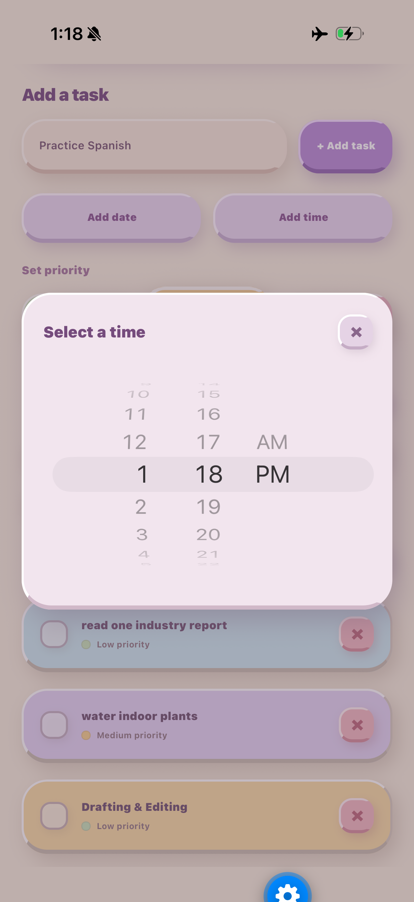

# MyTasks – A Simple Task Management App

A simple, user-friendly mobile task management application designed to help users organise their daily activities, manage priorities, and keep track of tasks.

MyTasks is a full-stack project built with React Native, Expo, Flask, and MySQL. It focuses on simplicity, usability, and a clean claymorphism-inspired interface.

---


## Table of Contents

- [Project Overview](#project-overview)
- [Application Screenshots](#application-screenshots)
- [Features](#features)
- [Technology Stack](#technology-stack)
- [System Architecture](#system-architecture)
- [Technology Choices and Design Decisions](#technology-choices-and-design-decisions)
- [Development Challenges and Solutions](#development-challenges-and-solutions)
- [My Role and Contributions](#my-role-and-contributions)
- [Project Status](#project-status)
- [Project Structure](#project-structure)
- [Prerequisites](#prerequisites)
- [Installation and Setup](#installation-and-setup)
- [Environment Variables](#environment-variables)
- [API Documentation](#api-documentation)
- [Database Structure](#database-structure)
- [Troubleshooting](#troubleshooting)
- [Future Improvements](#future-improvements)
- [Author](#author)
- [License](#license)

---

## Project Overview

MyTasks is a full-stack mobile task management application designed to help users organise daily activities, prioritise responsibilities, and manage tasks efficiently.

Built with React Native, Expo, Python Flask, and MySQL, the application combines a user-friendly mobile interface with a RESTful backend and persistent database storage. Its claymorphism-inspired design focuses on simplicity, visual clarity, and an engaging user experience.

---


## Application Screenshots

MyTasks features a soft claymorphism-inspired interface designed to make everyday task management simple, intuitive, and visually engaging.

<table>
  <tr>
    <td width="50%">
      
      <strong>1. Home Screen</strong>
      <p>The main dashboard displays task progress, task summaries, and the user's task list.</p>
    </td>
    <td width="50%">
      
      <strong>2. Add a Task</strong>
      <p>Users can create tasks by entering a title and selecting a priority level.</p>
    </td>
  </tr>
  <tr>
    <td width="50%">
      
      <strong>3. Date Picker</strong>
      <p>Users can select a due date using the calendar interface.</p>
    </td>
    <td width="50%">
      
      <strong>4. Time Picker</strong>
      <p>Users can optionally assign a specific time to a task.</p>
    </td>
  </tr>
  <tr>
    <td width="50%">
      
      <strong>5. Edit Task</strong>
      <p>Existing tasks can be updated, allowing users to modify task details and priorities.</p>
    </td>
    <td width="50%">
      
      <strong>6. Completed Tasks</strong>
      <p>Completed tasks are visually distinguished from pending tasks to help users track progress.</p>
    </td>
  </tr>
  <tr>
    <td width="50%">
      
      <strong>7. Task Management</strong>
      <p>Users can manage multiple tasks, monitor their status, and organise daily activities.</p>
    </td>
    <td width="50%">
    </td>
  </tr>
</table>


## Features

- **Create Tasks:** Add new tasks with a title and priority.
- **Edit Tasks:** Update existing task information.
- **Delete Tasks:** Remove tasks that are no longer needed.
- **Task Completion:** Mark tasks as completed or pending.
- **Priority Management:** Assign Low, Medium, or High priority levels.
- **Due Dates:** Set optional deadlines for tasks.
- **Due Times:** Add optional times to tasks.
- **Task Filtering:** Filter tasks by status and priority.
- **Task Sorting:** Organise tasks by their due dates.
- **Data Persistence:** Store tasks in a MySQL database.
- **Claymorphism UI:** Enjoy a soft, modern interface with pastel colours and raised visual elements.

---

## Technology Stack

| Area | Technology |
|---|---|
| Mobile Frontend | React Native |
| Development Framework | Expo |
| Programming Language | TypeScript |
| Backend | Python |
| Backend Framework | Flask |
| Database | MySQL |
| API Communication | REST API |
| API Testing | Browser / API testing tools |
| Version Control | Git |
| Code Hosting | GitHub |

---


## System Architecture

MyTasks follows a client-server architecture. The mobile application communicates with a Python Flask backend through REST API endpoints, while MySQL handles persistent data storage.

### Architecture Overview


```text
+--------------------------------------+
|          MOBILE APPLICATION          |
|          React Native + Expo         |
+--------------------------------------+
                   |
                   v
+--------------------------------------+
|             API SERVICE               |
|       frontend/src/services/api.ts    |
+--------------------------------------+
                   |
                   | HTTP Requests
                   v
+--------------------------------------+
|             FLASK BACKEND             |
|                Python                 |
|                app.py                 |
+--------------------------------------+
                   |
                   v
+--------------------------------------+
|          DATABASE CONNECTION          |
|              database.py              |
+--------------------------------------+
                   |
                   v
+--------------------------------------+
|            MYSQL DATABASE             |
|               mytasks_db              |
|                                       |
|              tasks table              |
+--------------------------------------+
```


### How the System Works

1. **Frontend:** Users interact with the mobile application built with React Native and Expo.
2. **API Service:** The frontend sends HTTP requests through the API service.
3. **Backend:** Flask receives requests, processes application logic and communicates with the database.
4. **Database Connection:** Python MySQL Connector establishes the connection between Flask and MySQL.
5. **Database:** MySQL stores task information, including titles, priorities, completion status, due dates and due times.
6. **Response:** The backend returns the requested data to the frontend, where the interface updates accordingly.

### Main Application Operations

| Operation | HTTP Method | API Endpoint | Purpose |
|---|---|---|---|
| Retrieve tasks | GET | `/tasks` | Fetch all tasks |
| Create task | POST | `/tasks` | Add a new task |
| Update task | PUT | `/tasks/<id>` | Edit or update a task |
| Delete task | DELETE | `/tasks/<id>` | Remove a task |

### Database Design

The application uses a MySQL database named mytasks_db with a tasks table to store task records. The database supports task creation, updates, completion tracking and optional scheduling.

## Technology Choices and Design Decisions

The technologies used in MyTasks were selected to support a simple, responsive and maintainable full-stack mobile application.

| Technology | Purpose | Reason for Selection |
|---|---|---|
| React Native | Mobile application development | Enables cross-platform mobile development |
| Expo | Development environment | Simplifies React Native development and testing |
| TypeScript | Frontend programming | Provides type safety and improves code maintainability |
| Python | Backend programming | Offers a clear and flexible backend development environment |
| Flask | REST API development | Lightweight framework for building API endpoints |
| MySQL | Database management | Provides structured and persistent data storage |

### Key Design Decisions

- **Client-server architecture:** Separates the mobile interface from backend processing and database operations.
- **REST API integration:** Allows the frontend and backend to communicate through HTTP requests.
- **Persistent storage:** Uses MySQL to retain tasks beyond individual application sessions.
- **Optional scheduling:** Allows users to create tasks with or without due dates and times.
- **Claymorphism UI:** Uses soft colours, layered shadows and rounded components to create a friendly interface.
- **Component-based development:** Organises the application into reusable and maintainable components.


## Development Challenges and Solutions

During the development of MyTasks, several technical challenges were encountered and addressed.

### 1. Frontend and Backend Communication

**Challenge:** Connecting the React Native application to the Flask backend during development, particularly when testing on a physical mobile device.

**Solution:** Configured the frontend to communicate with the backend using the computer's local network IP address instead of relying on `localhost`.

### 2. Database Integration

**Challenge:** Ensuring that tasks created or modified through the mobile application were correctly stored in MySQL.

**Solution:** Implemented a database connection using Python's MySQL Connector and integrated database operations into the Flask API.

### 3. Task Scheduling

**Challenge:** Supporting different task scheduling preferences, including tasks with only a date, only a time, both, or neither.

**Solution:** Implemented optional date and time fields and integrated date and time picker components into the application.

### 4. Modal and Picker Interaction

**Challenge:** Managing date and time picker interactions without allowing multiple picker windows to remain open simultaneously.

**Solution:** Implemented controlled modal visibility and outside-tap dismissal to improve the interaction experience.

### 5. User Interface Design

**Challenge:** Creating a visually engaging interface while maintaining readability and usability.

**Solution:** Applied a claymorphism-inspired design system with pastel colours, rounded components, layered shadows and consistent spacing.


## My Role and Contributions

I developed MyTasks as a full-stack mobile application, taking responsibility for both frontend and backend development, database integration and interface design.

### Frontend Development
- Developed the mobile application using React Native, Expo and TypeScript.
- Designed and implemented the claymorphism-inspired user interface.
- Built task creation, editing, deletion and completion functionality.
- Integrated date and time pickers.
- Implemented task filtering, sorting and priority selection.
- Connected the frontend to the Flask backend through API services.

### Backend Development
- Developed REST API endpoints using Python and Flask.
- Implemented CRUD operations for task management.
- Integrated the backend with MySQL.
- Handled API requests and responses between the frontend and database.
- Integrated frontend API services with backend endpoints to support end-to-end task management.

### Database Development
- Designed the MySQL tasks table.
- Implemented database connectivity using MySQL Connector.
- Managed task records, priorities, completion status and scheduling information.

### Documentation and Version Control
- Documented the project setup, architecture and API endpoints.
- Organised the project repository using Git and GitHub.
- Created environment variable examples and setup instructions.
- Documented application screenshots and development decisions.


## Project Status

**Status:** Functional portfolio project — local development version.

The application supports:
- Full CRUD operations for task management.
- Task scheduling with optional dates and times.
- Priority assignment and management.
- Task filtering and sorting.
- Persistent MySQL database storage.

The application is configured for local development and testing.

## Future Improvements

Potential improvements include:

- Push notifications and task reminders.
- Recurring tasks.
- User authentication and personalised task lists.
- Dark mode support.
- Improved analytics and productivity insights.
- Automated backend and frontend testing.
- Cloud deployment for wider accessibility.


## Project Structure

The project is organised into separate frontend and backend directories.

```text
MyTasks/
│
├── backend/
│   ├── app.py
│   ├── database.py
│   ├── test_db.py
│   ├── requirements.txt
│   ├── .env.example
│   └── .gitignore
│
├── frontend/
│   ├── src/
│   │   ├── app/
│   │   │   └── index.tsx
│   │   │
│   │   └── services/
│   │       └── api.ts
│   │
│   ├── package.json
│   ├── tsconfig.json
│   ├── .env.example
│   └── .gitignore
│
├── screenshots/
│   ├── 01-home-screen.PNG
│   ├── 02-add-task.PNG
│   ├── 03-date-picker.PNG
│   ├── 04-time-picker.PNG
│   ├── 05-edit-task.PNG
│   ├── 06-completed-tasks.PNG
│   └── 07-task-management.png
├── .gitignore
└── README.md
```

---

## Prerequisites

Before running the project, make sure you have the following installed:

- [Python](https://www.python.org/downloads/)
- [Node.js](https://nodejs.org/)
- [MySQL](https://dev.mysql.com/downloads/)
- [Git](https://git-scm.com/)
- [Expo Go](https://expo.dev/go) on your mobile device

You will also need a code editor, such as [Visual Studio Code](https://code.visualstudio.com/).

---

## Installation and Setup

### 1. Clone the Repository

Open your terminal and run:

```bash
git clone https://github.com/MichelleAnorchie/MyTasks.git
```

Navigate into the project directory:

```bash
cd MyTasks
```

### 2. Backend Setup

Navigate to the backend directory:

```bash
cd backend
```

Create a Python virtual environment:

```bash
python3 -m venv .venv
```

Activate the virtual environment on macOS or Linux:

```bash
source .venv/bin/activate
```

Install the required Python packages:

```bash
python3 -m pip install -r requirements.txt
```

### 3. Database Setup

Open MySQL Workbench or your MySQL terminal.

Create the database:

```sql
CREATE DATABASE mytasks_db;
```

Select the database:

```sql
USE mytasks_db;
```

Create the tasks table:

```sql
CREATE TABLE tasks (
    id INT NOT NULL AUTO_INCREMENT,
    title VARCHAR(255) NOT NULL,
    is_completed TINYINT(1) DEFAULT 0,
    priority ENUM('low', 'medium', 'high') DEFAULT 'medium',
    due_date DATE DEFAULT NULL,
    due_time TIME DEFAULT NULL,
    created_at TIMESTAMP DEFAULT CURRENT_TIMESTAMP,
    PRIMARY KEY (id)
);
```

### 4. Configure Backend Environment Variables

Inside the `backend` directory, create a file named `.env`.

Use the following format:

```env
DB_HOST=localhost
DB_USER=your_mysql_username
DB_PASSWORD=your_mysql_password
DB_NAME=mytasks_db
```

Replace the example username and password with your own MySQL credentials.

**Important:** Never upload your actual `.env` file or database password to GitHub.

### 5. Start the Backend Server

Make sure you are inside the `backend` directory and your virtual environment is activated.

Run:

```bash
python3 app.py
```
The backend runs on port `5001`. When testing on a physical mobile device, use your computer's local network IP address in the frontend environment configuration instead of `localhost`.


The Flask API should now be running on:

```text
http://localhost:5001
```

Keep this terminal running while using the application.

### 6. Frontend Setup

Open another terminal window.

Navigate to the frontend directory:

```bash
cd MyTasks/frontend
```
This is correct if the new terminal starts in the directory containing MyTasks

Install the frontend dependencies:

```bash
npm install
```

Create a `.env` file inside the `frontend` directory.

Add your computer's local network IP address:

```env
EXPO_PUBLIC_API_URL=http://YOUR_COMPUTER_IP:5001
```

Replace `YOUR_COMPUTER_IP` with your computer's current local network IP address.

For example:

```env
EXPO_PUBLIC_API_URL=http://192.168.1.10:5001
```

Your phone and computer should be connected to the same local network when testing over Wi-Fi.

### 7. Start the Mobile Application

From the frontend directory, run:

```bash
npx expo start
```

Open Expo Go on your mobile device and scan the QR code displayed in your terminal or browser.

The application should now connect to the Flask backend.

---

## Environment Variables

The project uses environment variables to keep configuration details separate from the application code.

### Backend

| Variable | Description |
|---|---|
| DB_HOST | MySQL server address |
| DB_USER | MySQL username |
| DB_PASSWORD | MySQL password |
| DB_NAME | Database name |

### Frontend

| Variable | Description |
|---|---|
| EXPO_PUBLIC_API_URL | URL of the Flask backend API |

Example environment files are provided in the repository:

- `backend/.env.example`
- `frontend/.env.example`

Copy these examples into `.env` files and update the values for your environment.

---

## API Documentation

The Flask backend provides REST API endpoints for managing tasks.

| Method | Endpoint | Description |
|---|---|---|
| GET | `/` | Check the API welcome route |
| GET | `/tasks` | Retrieve all tasks |
| POST | `/tasks` | Create a new task |
| PUT | `/tasks/<id>` | Update an existing task |
| DELETE | `/tasks/<id>` | Delete a task |

### Example: Create a Task

**Request**

```http
POST /tasks
```

**Example JSON Body**

```json
{
    "title": "Complete project documentation",
    "priority": "high",
    "due_date": "2026-12-01",
    "due_time": "14:30"
}
```

### Example: Update a Task

**Request**

```http
PUT /tasks/1
```

**Example JSON Body**

```json
{
    "title": "Complete project documentation",
    "priority": "medium",
    "is_completed": true
}
```

---

## Database Structure

The application uses MySQL to store task records.

### Tasks Table

| Column | Data Type | Description |
|---|---|---|
| id | INT | Unique task identifier |
| title | VARCHAR(255) | Task title |
| is_completed | TINYINT(1) | Completion status |
| priority | ENUM | Task priority |
| due_date | DATE | Optional task deadline |
| due_time | TIME | Optional task time |
| created_at | TIMESTAMP | Task creation date and time |

---

## Troubleshooting

### Backend Connection Issues

- Ensure the Flask server is running.
- Check that the API URL is correct.
- Confirm that your phone and computer are connected to the same network.
- Check your MySQL database credentials.

### MySQL Connection Issues

- Ensure MySQL Server is running.
- Confirm that the database `mytasks_db` exists.
- Check the credentials in your backend `.env` file.

### Frontend Issues

- Run `npm install` inside the frontend directory.
- Restart Expo after changing environment variables.
- Check that the backend URL uses your computer's current local IP address when testing on a physical device.

---

## Author

**Michelle Frimpomaah Anorchie**

Software Developer | Frontend Developer | UI/UX Designer

- GitHub: [MichelleAnorchie](https://github.com/MichelleAnorchie)
- Project Repository: [MyTasks](https://github.com/MichelleAnorchie/MyTasks)

---

## License

This project is currently developed for learning and portfolio purposes.
