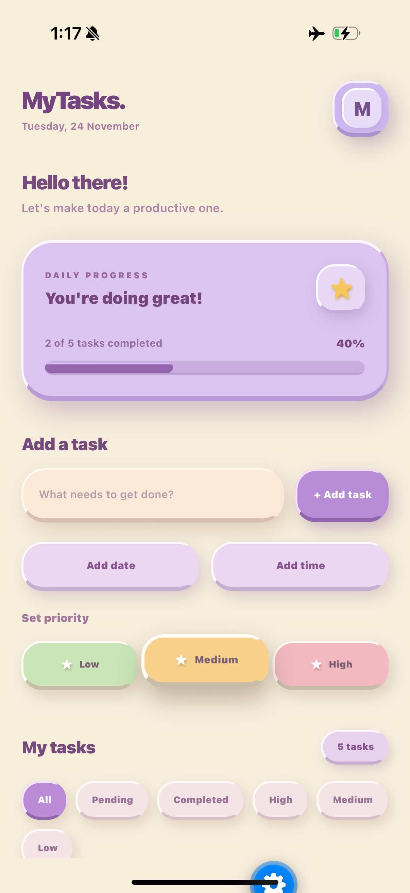
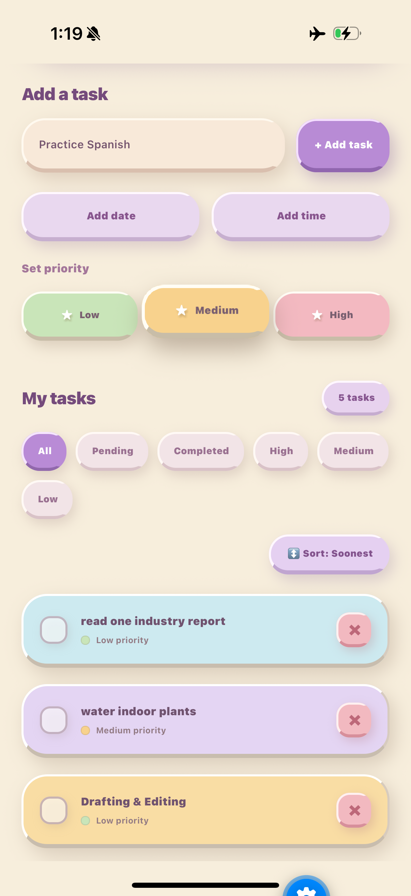
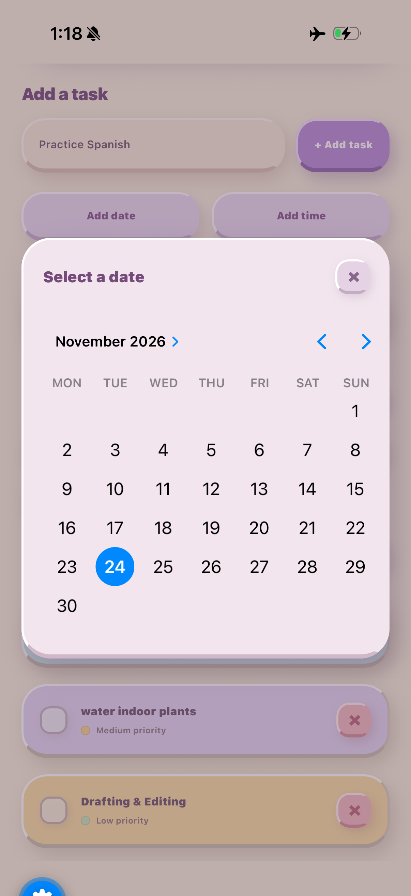
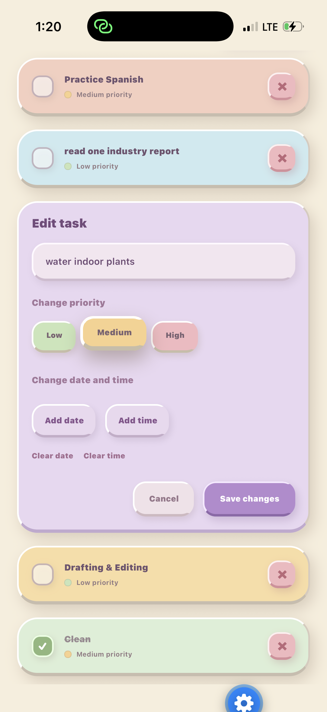
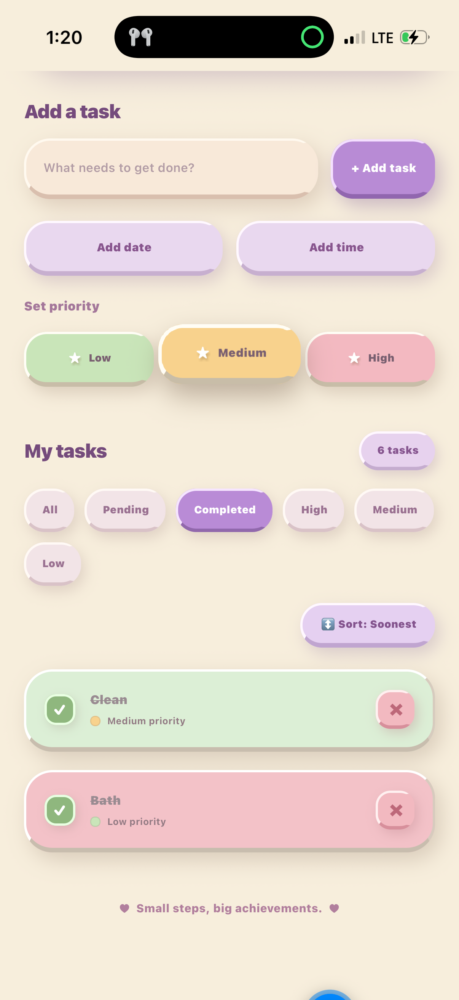
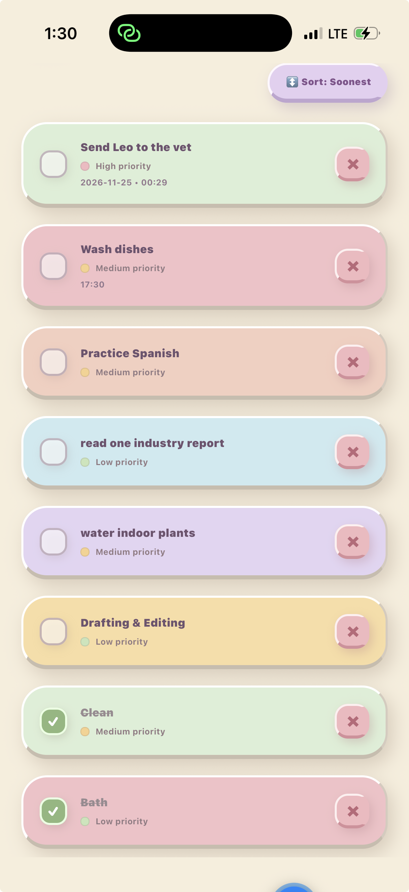

# MyTasks – A Simple Task Management App

A simple, user-friendly mobile task management application designed to help users organise their daily activities, manage priorities, and keep track of tasks.

MyTasks is a full-stack project built with React Native, Expo, Flask, and MySQL. It focuses on simplicity, usability, and a clean claymorphism-inspired interface.

---

## Table of Contents

- [Project Overview](#project-overview)
- [Features](#features)
- [Technology Stack](#technology-stack)
- [Project Structure](#project-structure)
- [Prerequisites](#prerequisites)
- [Installation and Setup](#installation-and-setup)
- [Environment Variables](#environment-variables)
- [API Documentation](#api-documentation)
- [Database Structure](#database-structure)
- [Troubleshooting](#troubleshooting)
- [Future Improvements](#future-improvements)
- [Author](#author)

---

## Project Overview

MyTasks is a mobile task management application that allows users to create, organise, update, and manage their daily tasks.

The application uses a React Native frontend to provide the mobile interface, a Flask backend to handle API requests, and a MySQL database to store task information.

The project follows a client-server architecture:

1. The user interacts with the mobile application.
2. The frontend sends requests to the Flask API.
3. The backend processes the requests and communicates with MySQL.
4. The database stores or retrieves the requested information.
5. The API sends the response back to the mobile application.

---


## Application Screenshots

MyTasks features a soft claymorphism-inspired interface designed to make everyday task management simple, intuitive, and visually engaging.

<table>
  <tr>
    <td width="50%">
      
      <strong>1. Home Screen</strong>
      <p>The main dashboard displays task progress, task summaries, and the user's task list.</p>
    </td>
    <td width="50%">
      
      <strong>2. Add a Task</strong>
      <p>Users can create tasks by entering a title and selecting a priority level.</p>
    </td>
  </tr>
  <tr>
    <td width="50%">
      
      <strong>3. Date Picker</strong>
      <p>Users can select a due date using the calendar interface.</p>
    </td>
    <td width="50%">
      
      <strong>4. Time Picker</strong>
      <p>Users can optionally assign a specific time to a task.</p>
    </td>
  </tr>
  <tr>
    <td width="50%">
      
      <strong>5. Edit Task</strong>
      <p>Existing tasks can be updated, allowing users to modify task details and priorities.</p>
    </td>
    <td width="50%">
      
      <strong>6. Completed Tasks</strong>
      <p>Completed tasks are visually distinguished from pending tasks to help users track progress.</p>
    </td>
  </tr>
  <tr>
    <td width="50%">
      
      <strong>7. Task Management</strong>
      <p>Users can manage multiple tasks, monitor their status, and organise daily activities.</p>
    </td>
    <td width="50%">
    </td>
  </tr>
</table>


## Features

- **Create Tasks:** Add new tasks with a title and priority.
- **Edit Tasks:** Update existing task information.
- **Delete Tasks:** Remove tasks that are no longer needed.
- **Task Completion:** Mark tasks as completed or pending.
- **Priority Management:** Assign Low, Medium, or High priority levels.
- **Due Dates:** Set optional deadlines for tasks.
- **Due Times:** Add optional times to tasks.
- **Task Filtering:** Filter tasks by status and priority.
- **Task Sorting:** Organise tasks by their due dates.
- **Data Persistence:** Store tasks in a MySQL database.
- **Claymorphism UI:** Enjoy a soft, modern interface with pastel colours and raised visual elements.

---

## Technology Stack

| Area | Technology |
|---|---|
| Mobile Frontend | React Native |
| Development Framework | Expo |
| Programming Language | TypeScript |
| Backend | Python |
| Backend Framework | Flask |
| Database | MySQL |
| API Communication | REST API |
| API Testing | Browser / API testing tools |
| Version Control | Git |
| Code Hosting | GitHub |

---

## Project Structure

The project is organised into separate frontend and backend directories.

```text
MyTasks/
│
├── backend/
│   ├── app.py
│   ├── database.py
│   ├── test_db.py
│   ├── requirements.txt
│   ├── .env.example
│   └── .gitignore
│
├── frontend/
│   ├── src/
│   │   ├── app/
│   │   │   └── index.tsx
│   │   │
│   │   └── services/
│   │       └── api.ts
│   │
│   ├── package.json
│   ├── tsconfig.json
│   ├── .env.example
│   └── .gitignore
│
├── .gitignore
└── README.md
```

---

## Prerequisites

Before running the project, make sure you have the following installed:

- [Python](https://www.python.org/downloads/)
- [Node.js](https://nodejs.org/)
- [MySQL](https://dev.mysql.com/downloads/)
- [Git](https://git-scm.com/)
- [Expo Go](https://expo.dev/go) on your mobile device

You will also need a code editor, such as [Visual Studio Code](https://code.visualstudio.com/).

---

## Installation and Setup

### 1. Clone the Repository

Open your terminal and run:

```bash
git clone https://github.com/MichelleAnorchie/MyTasks.git
```

Navigate into the project directory:

```bash
cd MyTasks
```

### 2. Backend Setup

Navigate to the backend directory:

```bash
cd backend
```

Create a Python virtual environment:

```bash
python3 -m venv .venv
```

Activate the virtual environment on macOS or Linux:

```bash
source .venv/bin/activate
```

Install the required Python packages:

```bash
python3 -m pip install -r requirements.txt
```

### 3. Database Setup

Open MySQL Workbench or your MySQL terminal.

Create the database:

```sql
CREATE DATABASE mytasks_db;
```

Select the database:

```sql
USE mytasks_db;
```

Create the tasks table:

```sql
CREATE TABLE tasks (
    id INT NOT NULL AUTO_INCREMENT,
    title VARCHAR(255) NOT NULL,
    is_completed TINYINT(1) DEFAULT 0,
    priority ENUM('low', 'medium', 'high') DEFAULT 'medium',
    due_date DATE DEFAULT NULL,
    due_time TIME DEFAULT NULL,
    created_at TIMESTAMP DEFAULT CURRENT_TIMESTAMP,
    PRIMARY KEY (id)
);
```

### 4. Configure Backend Environment Variables

Inside the `backend` directory, create a file named `.env`.

Use the following format:

```env
DB_HOST=localhost
DB_USER=your_mysql_username
DB_PASSWORD=your_mysql_password
DB_NAME=mytasks_db
```

Replace the example username and password with your own MySQL credentials.

**Important:** Never upload your actual `.env` file or database password to GitHub.

### 5. Start the Backend Server

Make sure you are inside the `backend` directory and your virtual environment is activated.

Run:

```bash
python3 app.py
```

The Flask API should now be running on:

```text
http://localhost:5001
```

Keep this terminal running while using the application.

### 6. Frontend Setup

Open another terminal window.

Navigate to the frontend directory:

```bash
cd MyTasks/frontend
```

Install the frontend dependencies:

```bash
npm install
```

Create a `.env` file inside the `frontend` directory.

Add your computer's local network IP address:

```env
EXPO_PUBLIC_API_URL=http://YOUR_COMPUTER_IP:5001
```

Replace `YOUR_COMPUTER_IP` with your computer's current local network IP address.

For example:

```env
EXPO_PUBLIC_API_URL=http://192.168.1.10:5001
```

Your phone and computer should be connected to the same local network when testing over Wi-Fi.

### 7. Start the Mobile Application

From the frontend directory, run:

```bash
npx expo start
```

Open Expo Go on your mobile device and scan the QR code displayed in your terminal or browser.

The application should now connect to the Flask backend.

---

## Environment Variables

The project uses environment variables to keep configuration details separate from the application code.

### Backend

| Variable | Description |
|---|---|
| DB_HOST | MySQL server address |
| DB_USER | MySQL username |
| DB_PASSWORD | MySQL password |
| DB_NAME | Database name |

### Frontend

| Variable | Description |
|---|---|
| EXPO_PUBLIC_API_URL | URL of the Flask backend API |

Example environment files are provided in the repository:

- `backend/.env.example`
- `frontend/.env.example`

Copy these examples into `.env` files and update the values for your environment.

---

## API Documentation

The Flask backend provides REST API endpoints for managing tasks.

| Method | Endpoint | Description |
|---|---|---|
| GET | `/` | Check the API welcome route |
| GET | `/tasks` | Retrieve all tasks |
| POST | `/tasks` | Create a new task |
| PUT | `/tasks/<id>` | Update an existing task |
| DELETE | `/tasks/<id>` | Delete a task |

### Example: Create a Task

**Request**

```http
POST /tasks
```

**Example JSON Body**

```json
{
    "title": "Complete project documentation",
    "priority": "high",
    "due_date": "2026-12-01",
    "due_time": "14:30"
}
```

### Example: Update a Task

**Request**

```http
PUT /tasks/1
```

**Example JSON Body**

```json
{
    "title": "Complete project documentation",
    "priority": "medium",
    "is_completed": true
}
```

---

## Database Structure

The application uses MySQL to store task records.

### Tasks Table

| Column | Data Type | Description |
|---|---|---|
| id | INT | Unique task identifier |
| title | VARCHAR(255) | Task title |
| is_completed | TINYINT(1) | Completion status |
| priority | ENUM | Task priority |
| due_date | DATE | Optional task deadline |
| due_time | TIME | Optional task time |
| created_at | TIMESTAMP | Task creation date and time |

---

## Troubleshooting

### Backend Connection Issues

- Ensure the Flask server is running.
- Check that the API URL is correct.
- Confirm that your phone and computer are connected to the same network.
- Check your MySQL database credentials.

### MySQL Connection Issues

- Ensure MySQL Server is running.
- Confirm that the database `mytasks_db` exists.
- Check the credentials in your backend `.env` file.

### Frontend Issues

- Run `npm install` inside the frontend directory.
- Restart Expo after changing environment variables.
- Check that the backend URL uses your computer's current local IP address when testing on a physical device.

---

## Future Improvements

Potential future improvements include:

- User authentication and personal task accounts.
- Push notifications and task reminders.
- Recurring tasks.
- Task categories and labels.
- Cloud deployment.
- Improved analytics and productivity insights.

---

## Author

**Michelle Frimpomaah Anorchie**

Software Developer | Frontend Developer | UI/UX Designer

- GitHub: [MichelleAnorchie](https://github.com/MichelleAnorchie)
- Project Repository: [MyTasks](https://github.com/MichelleAnorchie/MyTasks)

---

## License

This project is currently developed for learning and portfolio purposes.
