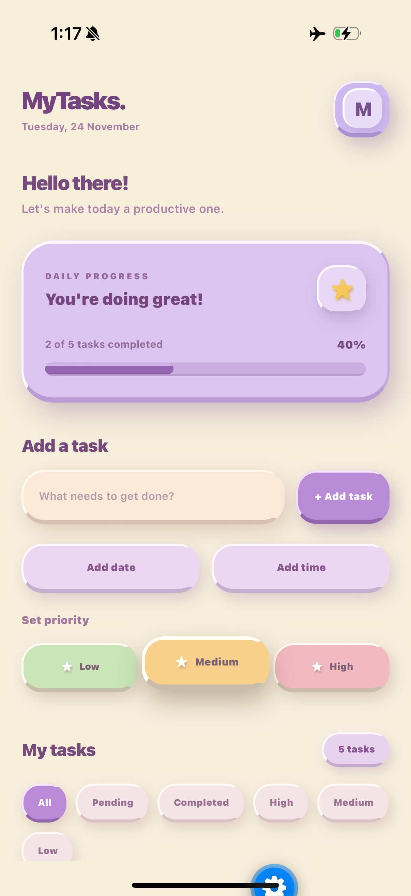
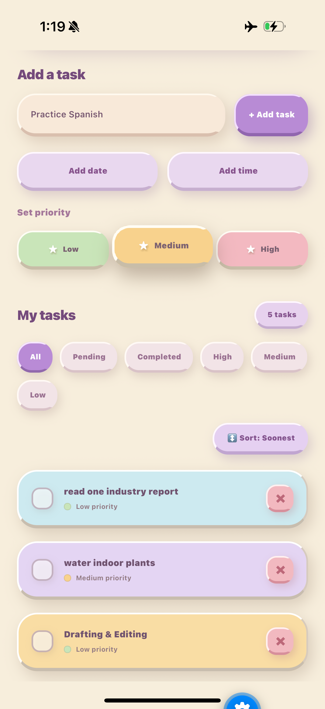
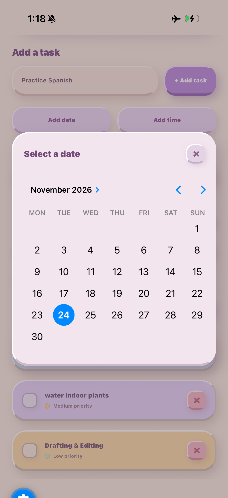
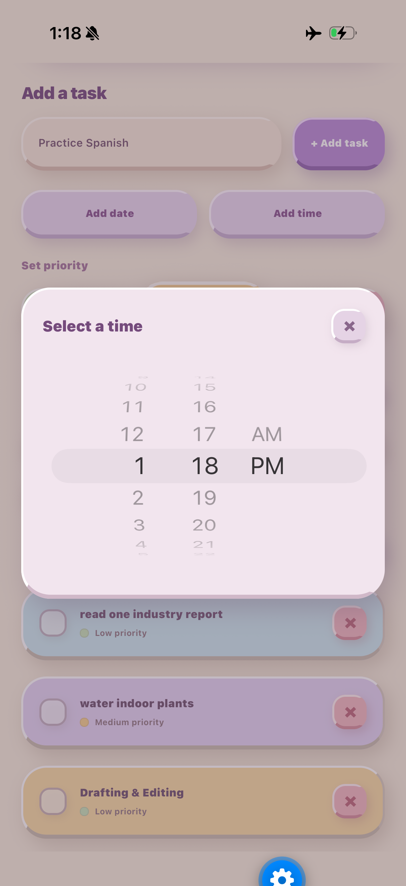
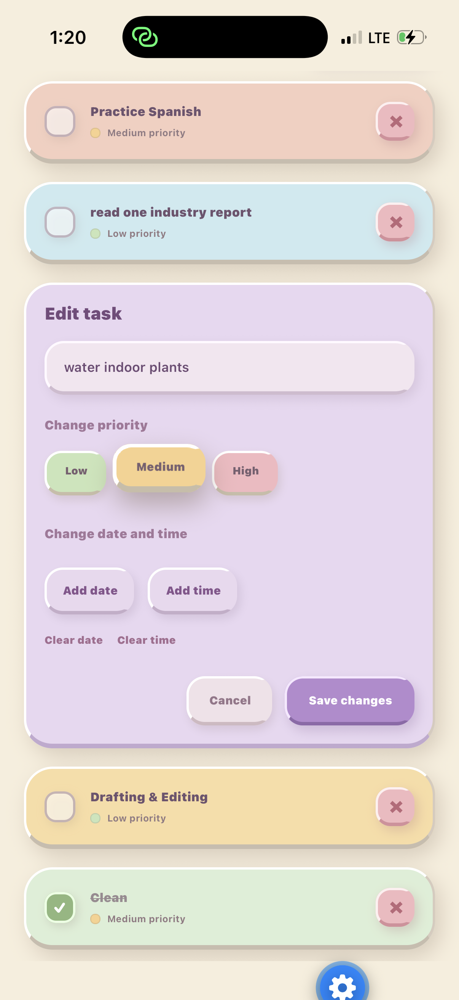
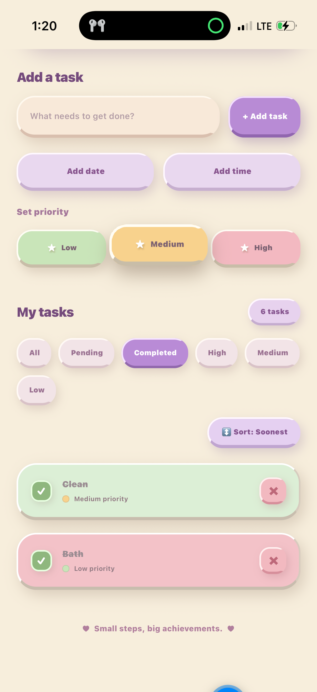
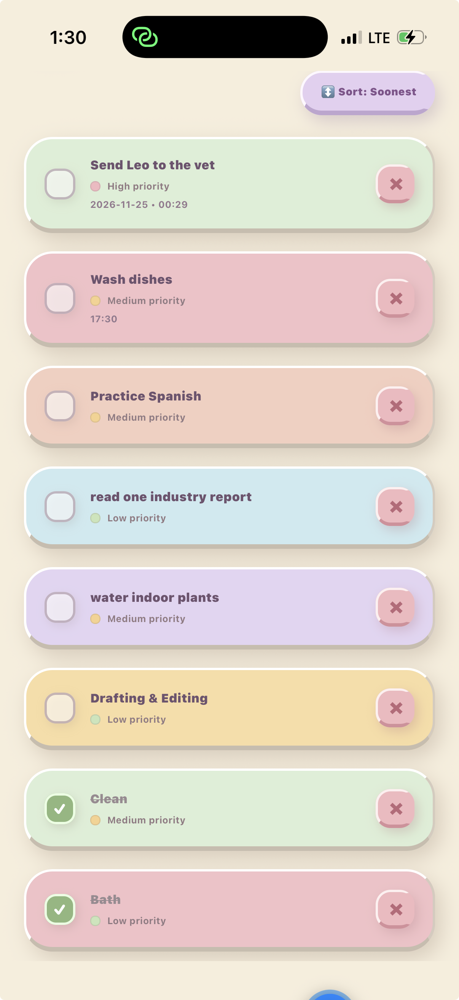

# MyTasks

## A Simple, User-Centred Task Management App

| Project Detail | Description |
|---|---|
| **Project Type** | Full-Stack Mobile Application |
| **My Role** | UI/UX Designer & Full-Stack Developer |
| **Frontend** | React Native, Expo, TypeScript |
| **Backend** | Python, Flask |
| **Database** | MySQL |
| **Design Style** | Claymorphism |
| **Project Status** | Functional local development version |

---

## Table of Contents

1. [Project Overview](#1-project-overview)
2. [Problem Statement](#2-problem-statement)
3. [Project Goal](#3-project-goal)
4. [User Research](#4-user-research)
5. [Design Goals](#5-design-goals)
6. [User Flow](#6-user-flow)
7. [Visual Design Direction](#7-visual-design-direction)
8. [Technical Architecture](#8-technical-architecture)
9. [Key Features and Functionality](#9-key-features-and-functionality)
10. [Development Challenges and Solutions](#10-development-challenges-and-solutions)
11. [My Role and Contributions](#11-my-role-and-contributions)
12. [Project Outcome](#12-project-outcome)
13. [Lessons Learned](#13-lessons-learned)
14. [Future Improvements](#14-future-improvements)
15. [Project Links](#15-project-links)

---

## 1. Project Overview

MyTasks is a mobile task management application designed to help users organise their daily activities, manage priorities, and monitor their progress through a simple and intuitive interface.

The application combines practical task management functionality with a soft claymorphism-inspired visual design. Its interface uses pastel colours, rounded surfaces, and subtle shadows to create a friendly and approachable experience.

The project involved designing and developing a complete mobile application, including its frontend, backend API, and relational database.

### Application Preview


<div align="center">
  
  <p><em>The MyTasks dashboard, showing the task management interface.</em></p>
</div>


---

## 2. Problem Statement

Managing everyday activities can become overwhelming when tasks are scattered across different places or when task management applications feel unnecessarily complicated.

Users need a straightforward way to create tasks, assign priorities, schedule activities, and monitor completed work without navigating a cluttered interface.

MyTasks addresses this need by providing a simple environment where users can manage their daily activities and keep track of their progress.

---

## 3. Project Goal

The goal was to design and develop a simple, accessible, and visually engaging mobile application that makes everyday task management easier.

The application focuses on:

- Clear task organisation.
- Intuitive task creation and management.
- Flexible priority and scheduling options.
- Visual feedback on task progress.
- Reliable data storage through a backend API and MySQL database.

---

## 4. User Research

Before developing MyTasks, I held informal conversations with eight participants aged 16–40 to gain a better understanding of their everyday task-management habits and preferences.

The conversations explored how participants organise their daily activities, keep track of outstanding tasks, manage priorities, and what they value in a task management application.

### Research Objectives

- Understand how people organise and track their daily tasks.
- Explore common difficulties with managing activities and priorities.
- Identify features that could make everyday task management easier.
- Understand preferences for a simple and intuitive interface.

### Design Principles

The research direction informed four key design principles:

1. **Simplicity:** Keep the interface clean and easy to understand.
2. **Speed:** Make common actions quick and straightforward.
3. **Minimalism:** Avoid unnecessary visual clutter and complicated navigation.
4. **User-Centred Design:** Prioritise usability and practical user needs.

### How the Research Informed the Design

These principles guided the design and development of MyTasks, particularly its task creation flow, priority selection, optional scheduling features, and visual organisation.

---

## 5. Design Goals

The design of MyTasks focused on creating an experience that makes managing everyday activities simple, organised, and enjoyable.

The following goals guided the interface and interaction design.

### 5.1 Create a Simple Interface

Design a clean and intuitive interface that allows users to understand the application without unnecessary complexity.

### 5.2 Make Task Management Easy

Allow users to quickly create, edit, complete, and delete tasks with minimal effort.

### 5.3 Improve Task Organisation

Provide priority levels, optional due dates, and time scheduling to help users organise their activities.

### 5.4 Provide Clear Visual Feedback

Use visual indicators, task states, and progress information to help users understand their activities at a glance.

### 5.5 Create an Engaging Visual Experience

Use a soft claymorphism-inspired design with pastel colours, rounded elements, and subtle shadows while maintaining usability.

### 5.6 Ensure Reliable Data Storage

Connect the mobile application to a backend API and MySQL database so that tasks remain saved when the application is reopened.

### Design Priorities

- Minimal and uncluttered layouts.
- Consistent spacing and visual hierarchy.
- Clear task priority indicators.
- Easy-to-use controls and interactions.
- Consistent visual styling across application screens.

---

## 6. User Flow

The user flow was designed to keep task management straightforward, allowing users to perform common actions without navigating through complicated menus.

### Main User Journey

1. **Open the application:** The user lands on the main dashboard.
2. **View tasks:** The user sees existing tasks and overall task progress.
3. **Create a task:** The user selects the add-task control and enters a task title.
4. **Set task details:** The user selects a priority and can optionally add a due date or time.
5. **Save the task:** The task is sent to the backend and stored in the MySQL database.
6. **Manage tasks:** The user can edit task details, change priorities, or delete tasks.
7. **Complete a task:** The user marks a task as completed.
8. **Track progress:** The dashboard updates to reflect task completion progress.

### Task Management Flow

```text
Dashboard
    |
    v
Add Task
    |
    v
Enter Task Details
    |
    v
Save Task
    |
    v
View Task
    |
    v
Edit, Complete, or Delete
```

### Task Creation


<div align="center">
  
  <p><em>The task creation interface allows users to enter task details and select a priority.</em></p>
</div>


### Interaction Considerations

- Task creation should require minimal input.
- Due dates and times should remain optional.
- Users should be able to edit existing tasks.
- Completed and pending tasks should be visually distinguishable.
- Pop-up interactions should be easy to dismiss.

---

## 7. Visual Design Direction

### 7.1 Design Concept

MyTasks uses a soft claymorphism-inspired visual style to create a friendly, approachable, and visually engaging interface.

The design combines pastel colours, rounded surfaces, subtle shadows, and raised elements to give interface components a soft, tactile appearance.

The intention was to make everyday task management feel less overwhelming while maintaining a clear and functional layout.

### 7.2 Colour Palette

The interface uses a collection of soft pastel colours to distinguish task cards and interface elements while maintaining a consistent visual identity.

The colours create visual variety without making the application feel cluttered or overwhelming.

### 7.3 Claymorphism

Claymorphism was selected as the primary visual design direction.

Its main characteristics include:

- Soft, rounded shapes and surfaces.
- Subtle outer shadows that create a raised appearance.
- Light highlights that add depth to interface elements.
- Pastel-coloured cards and interactive components.
- Consistent spacing and rounded corners.

### 7.4 Visual Hierarchy

The interface uses size, spacing, colour, and contrast to guide users through the application.

Important information, such as task titles, progress indicators, and priority levels, is made easy to identify.

### 7.5 Interaction Design

Interactive elements use raised surfaces and visual feedback to make controls feel more responsive.

Priority chips, buttons, task cards, and pop-up interfaces follow a consistent visual language to create a cohesive experience.

### Application Screens

<table>
  <tr>
    <td align="center" width="50%">
      
      <br>
      <strong>Home Dashboard</strong>
      <br>
      <em>The main dashboard displaying tasks and progress.</em>
    </td>
    <td align="center" width="50%">
      
      <br>
      <strong>Add Task</strong>
      <br>
      <em>Creating a task and selecting its priority.</em>
    </td>
  </tr>
  <tr>
    <td align="center" width="50%">
      
      <br>
      <strong>Date Picker</strong>
      <br>
      <em>Selecting an optional task due date.</em>
    </td>
    <td align="center" width="50%">
      
      <br>
      <strong>Time Picker</strong>
      <br>
      <em>Selecting an optional task due time.</em>
    </td>
  </tr>
  <tr>
    <td align="center" width="50%">
      
      <br>
      <strong>Edit Task</strong>
      <br>
      <em>Updating an existing task.</em>
    </td>
    <td align="center" width="50%">
      
      <br>
      <strong>Completed Tasks</strong>
      <br>
      <em>Viewing tasks that have been completed.</em>
    </td>
  </tr>
  <tr>
    <td align="center" width="50%">
      
      <br>
      <strong>Task Management</strong>
      <br>
      <em>Managing and organising tasks.</em>
    </td>
    <td width="50%"></td>
  </tr>
</table>

---

## 8. Technical Architecture

MyTasks was developed using a client-server architecture that separates the mobile application, backend services, and database.

This structure allows each part of the application to handle a specific responsibility while communicating through a REST API.

### 8.1 Technology Stack

| Layer | Technology | Purpose |
|---|---|---|
| Mobile Frontend | React Native | Builds the mobile user interface |
| Development Framework | Expo | Simplifies React Native development and testing |
| Programming Language | TypeScript | Provides type safety in the frontend |
| Backend | Python and Flask | Handles application logic and API requests |
| Database | MySQL | Stores task information persistently |
| API Communication | REST API | Connects the frontend and backend |

### 8.2 System Architecture

The application follows this communication flow:

```text
┌────────────────────────────┐
│     React Native + Expo    │
│       Mobile Frontend      │
└──────────────┬─────────────┘
               │
               │ HTTP Requests
               ▼
┌────────────────────────────┐
│       Flask Backend        │
│         REST API           │
└──────────────┬─────────────┘
               │
               │ SQL Queries
               ▼
┌────────────────────────────┐
│       MySQL Database       │
│         mytasks_db         │
└────────────────────────────┘
```

### 8.3 How the System Works

1. The user interacts with the React Native mobile application.
2. The frontend sends HTTP requests to the Flask backend.
3. Flask processes the requests and communicates with the MySQL database.
4. MySQL stores or retrieves the requested task information.
5. The backend returns a response to the frontend.
6. The frontend updates the interface with the returned data.

### 8.4 Database Design

The application uses a MySQL database named `mytasks_db`, containing a `tasks` table.

Each task record stores information such as:

| Field | Description |
|---|---|
| `id` | Unique task identifier |
| `title` | Task title |
| `is_completed` | Completion status |
| `priority` | Task priority: low, medium, or high |
| `due_date` | Optional due date |
| `due_time` | Optional due time |
| `created_at` | Task creation timestamp |

This architecture keeps database operations on the backend rather than connecting the mobile application directly to MySQL.

---

## 9. Key Features and Functionality

MyTasks combines essential task management features with a simple interface to help users organise their daily activities.

### 9.1 Task Creation

Users can create new tasks by entering a title and selecting a priority level.

### 9.2 Task Editing

Existing tasks can be updated, allowing users to modify task titles, priorities, and scheduling details.

### 9.3 Task Completion

Users can mark tasks as completed or return them to pending status.

### 9.4 Task Deletion

Users can delete tasks they no longer need.

### 9.5 Priority Management

Tasks can be assigned one of three priority levels:

- Low
- Medium
- High

### 9.6 Optional Date and Time Scheduling

Users can assign due dates and times to tasks. Both fields are optional and can be used independently.


### Date and Time Selection

<table>
  <tr>
    <td align="center" width="50%">
      
      <br>
      <strong>Date Picker</strong>
      <br>
      <em>Selecting an optional task due date.</em>
    </td>
    <td align="center" width="50%">
      
      <br>
      <strong>Time Picker</strong>
      <br>
      <em>Selecting an optional task due time.</em>
    </td>
  </tr>
</table>


### 9.7 Task Filtering

Users can organise their task list using the following filters:

- All tasks
- Pending tasks
- Completed tasks
- Low priority
- Medium priority
- High priority

### 9.8 Task Sorting

Users can sort tasks based on their due dates to make upcoming activities easier to identify.

### 9.9 Progress Tracking

The dashboard provides visual information about task progress, helping users monitor completed and outstanding activities.

### 9.10 Persistent Data Storage

Tasks are stored in a MySQL database through the Flask backend, allowing task information to remain available when the application is reopened.

---

## 10. Development Challenges and Solutions

During the development of MyTasks, I encountered several technical and implementation challenges. Working through these challenges helped me improve my understanding of frontend development, backend integration, database management, and mobile application behaviour.

### 10.1 Connecting the Mobile Frontend to the Backend

**Challenge:** Connecting the React Native application to the Flask backend required configuring communication between two separate development environments.

**Solution:** I implemented API service functions to handle HTTP requests and configured the frontend to communicate with the Flask server using its local network IP address when testing on a physical device.

### 10.2 Integrating MySQL with Flask

**Challenge:** Establishing reliable communication between the backend and MySQL database required configuring database credentials and managing database connections.

**Solution:** I used `mysql-connector-python` and environment variables to configure database access and keep sensitive credentials outside the source code.

### 10.3 Implementing Task Updates

**Challenge:** Supporting task editing, completion, and deletion required coordinating frontend state changes with backend database operations.

**Solution:** I implemented separate API operations for creating, retrieving, updating, and deleting tasks, allowing the frontend to communicate with the database through the Flask backend.

### 10.4 Managing Optional Scheduling Fields

**Challenge:** Tasks needed to support different scheduling combinations, including a date only, a time only, both, or neither.

**Solution:** I implemented independent optional date and time fields so users could schedule tasks according to their needs without making either field mandatory.

### 10.5 Improving Pop-up Interactions

**Challenge:** Managing date and time pickers required preventing multiple pop-ups from appearing simultaneously and ensuring they could be dismissed easily.

**Solution:** I refined the modal interaction logic so only one picker could be open at a time and users could dismiss it by tapping outside the pop-up.

### 10.6 Maintaining a Consistent Claymorphism Design

**Challenge:** Applying consistent shadows, highlights, rounded surfaces, and raised effects across different interface components required careful styling.

**Solution:** I refined component styling, spacing, shadow properties, and selected-state feedback to create a more consistent visual experience.

---

## 11. My Role and Contributions

I worked on MyTasks as both the UI/UX designer and full-stack developer, taking responsibility for the design, implementation, and integration of the application.

My contributions covered the following areas.

### UI/UX Design

- Established the visual direction and claymorphism-inspired design style.
- Designed the layout and visual hierarchy of the application.
- Refined task cards, priority indicators, buttons, and interactive components.
- Focused on simplicity, usability, and consistent visual presentation.

### Frontend Development

- Developed the mobile interface using React Native and Expo.
- Implemented task creation, editing, completion, and deletion interfaces.
- Built task filtering and sorting functionality.
- Implemented date and time picker interactions.
- Connected frontend services to the backend API.

### Backend Development

- Developed backend functionality using Python and Flask.
- Implemented REST API endpoints for task management.
- Integrated the backend with MySQL.
- Implemented database operations for creating, retrieving, updating, and deleting tasks.
- Integrated frontend API services with backend endpoints to support end-to-end task management.

### Database Development

- Designed the MySQL database structure for storing task records.
- Implemented database connectivity and environment-based configuration.
- Supported persistent storage of task information.

### Testing and Refinement

- Tested the application using Expo Go on a physical mobile device.
- Checked task management operations and database persistence.
- Refined interface interactions and visual consistency.
- Resolved issues encountered during development and integration.

---

## 12. Project Outcome

MyTasks was developed as a functional full-stack mobile application that combines task management functionality with a claymorphism-inspired user interface.

The completed application demonstrates the integration of a React Native frontend, Flask backend, and MySQL database.

### Key Achievements

- Developed a functional mobile task management application.
- Implemented complete task CRUD operations.
- Integrated the frontend with a Flask REST API.
- Connected the backend to a MySQL database.
- Implemented task priorities, filtering, and sorting.
- Added optional date and time scheduling.
- Created a consistent claymorphism-inspired interface.
- Tested the application on a physical mobile device using Expo Go.

The project provided practical experience in building, integrating, testing, and documenting a full-stack mobile application.

---

## 13. Lessons Learned

Building MyTasks strengthened my understanding of both software development and user-centred design.

### Technical Lessons

- Understanding how frontend and backend systems communicate.
- Building REST APIs with Flask.
- Connecting applications to relational databases using MySQL.
- Managing application state and asynchronous API requests.
- Handling network configuration when testing mobile applications.
- Structuring a full-stack application into separate layers.

### Design Lessons

- The importance of simplicity and clear visual hierarchy.
- Maintaining consistency across interface components.
- Using colour and visual feedback to improve usability.
- Balancing visual appeal with practical functionality.
- Considering user interactions when designing interface components.

### Personal Growth

This project improved my confidence in taking an application from an initial concept through design, implementation, testing, and documentation.

It also strengthened my ability to identify development challenges, investigate solutions, and refine an application through continuous testing.

---

## 14. Future Improvements

Although MyTasks provides the core functionality of a task management application, there are several opportunities to improve and expand the application in future versions.

### 14.1 Push Notifications and Reminders

Introduce notifications to remind users about upcoming tasks and approaching deadlines.

### 14.2 Recurring Tasks

Allow users to create tasks that repeat daily, weekly, or monthly.

### 14.3 Cloud Deployment

Deploy the backend and database to a cloud environment so users can access their tasks without relying on a locally running development server.

### 14.4 Improved Accessibility

Further improve accessibility through better support for screen readers, readable text sizes, and colour contrast.

### 14.5 User Accounts and Synchronisation

Introduce optional user accounts and secure authentication to allow users to access their tasks across multiple devices.

### 14.6 Enhanced Task Organisation

Explore additional organisation options such as categories, tags, search, and custom task groupings.

These improvements could expand the application's capabilities while maintaining its original focus on simplicity and usability.

---

## 15. Project Links

- **GitHub Repository:** [MyTasks – GitHub](https://github.com/MichelleAnorchie/MyTasks)
- **Live Demo:** Not currently available. The application runs locally during development using Expo Go.

---

*MyTasks — Designed and developed as a full-stack mobile application, with a focus on simplicity, usability, and thoughtful visual design.*
